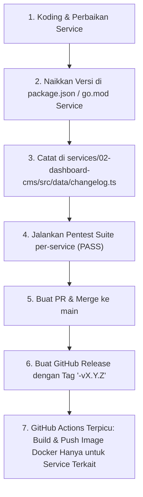

# HeroCMS Independent Service Release & Docker CI/CD Policy (`herocms-independent-release-flow`)

Dokumen standar operasional prosedur untuk rilis produk/service, penamaan Git Tag per-service, dan kebijakan pembuatan Docker image di HeroCMS Monorepo.

---

## 1. Prinsip Utama: Pembuatan Image Docker HANYA Lewat Release

> [!IMPORTANT]
> **KEBIJAKAN MUTLAK CI/CD:**
> 1. Pembuatan (*build*) dan pengunggahan (*push*) Docker image ke Docker Hub **HANYA BISA DAN HANYA BOLEH DILAKUKAN MELALUI EVENT GITHUB RELEASE** (`on: release: types: [published]`).
> 2. **DILARANG KERAS** memicu build & push Docker image saat ada event `git push` ke branch `main`, `master`, `feat/**`, atau branch manapun.
> 3. Push ke branch hanya boleh digunakan untuk sinkronisasi kode atau verifikasi testing (tanpa upload image ke registry).

---

## 2. Format Standar Git Tag Rilis Independen (*Service-Scoped Tagging*)

HeroCMS terdiri dari 7 microservices yang masing-masing memiliki siklus rilis dan penomoran versi mandiri (*Independent Semantic Versioning*). Format Git Tag resmi yang digunakan:

| Service ID & Nama | Format Tag Resmi | Format Tag Alias | Target Docker Image |
| :--- | :--- | :--- | :--- |
| **07-docs** (Docs & Mission Control) | `07-docs-v<SemVer>` | `docs-v<SemVer>` | `roxas0800/herocms-docs:<SemVer>` |
| **02-dashboard-cms** (Dashboard Studio) | `02-dashboard-v<SemVer>` | `dashboard-v<SemVer>` | `roxas0800/herocms-dashboard:<SemVer>` |
| **04-marketing-site** (Public Landing) | `04-marketing-v<SemVer>` | `marketing-v<SemVer>` | `roxas0800/herocms-marketing:<SemVer>` |
| **03-provision-orchestrator** (Docker Engine) | `03-orchestrator-v<SemVer>` | `orchestrator-v<SemVer>` | `roxas0800/herocms-orchestrator:<SemVer>` |
| **05-ai-agent-service** (AI Workflows) | `05-ai-agent-v<SemVer>` | `ai-agent-v<SemVer>` | `roxas0800/herocms-ai-agent:<SemVer>` |
| **Platform Suite Milestone** (Seluruh Layanan) | `v<SemVer>` (e.g. `v1.15.0`) | - | Build semua image serentak |

### Contoh Penggunaan Nyata:
- Anda memperbaiki tombol & layout di Docs Hub: Buat rilis dengan tag **`07-docs-v1.4.1`** (atau `docs-v1.4.1`).
- Anda menambah fitur template di Dashboard Studio: Buat rilis dengan tag **`02-dashboard-v1.14.28`**.
- Anda merilis landing page promosi baru: Buat rilis dengan tag **`04-marketing-v1.9.2`**.

---

## 3. Alur Kerja Rilis Bertahap (Step-by-Step SOP)



### Langkah 1: Sinkronisasi Nomor Versi
Perbarui versi pada file konfigurasi service yang diubah:
- Contoh jika mengedit Docs Hub: perbarui `version: "1.4.1"` di `services/07-docs/package.json`.

### Langkah 2: Catat Changelog Resmi
Tambahkan entri rilis baru pada:
`services/02-dashboard-cms/src/data/changelog.ts`

### Langkah 3: Eksekusi Pentest Suite Per-Service
Pastikan tes keamanan berstatus `PASS`:
```bash
cd services/<service-folder>
go test -v ./pentest/...
```

### Langkah 4: Buka Pull Request & Merge ke `main`
Lakukan merge branch fitur ke branch utama `main` melalui PR.

### Langkah 5: Publikasikan GitHub Release
Buka GitHub Releases atau gunakan GitHub API/CLI untuk mempublikasikan Release:
- **Tag**: `07-docs-v1.4.1` (atau `02-dashboard-v1.14.28`)
- **Title**: `Release 07-docs-v1.4.1: Judul Ringkas Perubahan`
- **Target**: `main`

---

## 4. Perilaku Otomatisasi CI/CD (`.github/workflows/docker-release.yml`)

Ketika release dipublikasikan dengan tag `07-docs-v1.4.1`:
1. Workflow membaca prefix `07-docs` (atau `docs`).
2. Workflow **HANYA** menjalankan build dan push untuk image `roxas0800/herocms-docs`.
3. Service lain (`dashboard`, `marketing`, `orchestrator`) **TIDAK IKUT DIBUILD**, menghemat waktu dan kuota runner GitHub Actions.
4. Image Docker diberi tag yang presisi:
   - `roxas0800/herocms-docs:1.4.1`
   - `roxas0800/herocms-docs:v1.4.1`
   - `roxas0800/herocms-docs:latest`
   - `roxas0800/herocms-docs:sha-<commit>`
