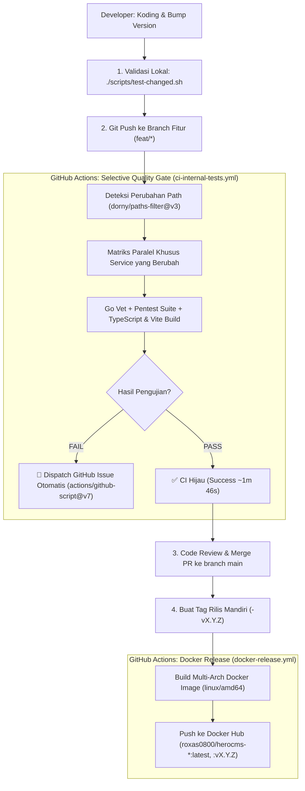

# Panduan Lingkungan Pengembangan, Infrastruktur & Operasional (Runbook)

## 1. Tata Letak Direktori Monorepo

Untuk menjaga pemisahan modul yang rapi sekaligus mempermudah berbagi skema data dan orkestrasi lokal, struktur repositori ditata sebagai berikut:

```
docker-cms/
├── docs/                                # Dokumentasi Teknis & PRD Lengkap
│   ├── PRD.md                           # Dokumen Kebutuhan Produk (PRD) Master
│   ├── ARCHITECTURE_AND_TECH_SPEC.md    # Arsitektur sistem & spesifikasi teknis
│   ├── SECURITY_AND_SANDBOXING.md       # Keamanan, isolasi kontainer & kepatuhan
│   ├── AI_AGENT_SERVICE.md              # Spesifikasi AI engine & analitik telemetri
│   └── DEV_ENVIRONMENT_AND_RUNBOOK.md   # Panduan operasional & dev lingkungan ini
│
├── deploy/                              # Definisi Infrastruktur Bersama & Ingress
│   ├── docker-compose.infra.yml         # Layanan shared (Traefik, Postgres, Redis, Redpanda, MinIO, n8n)
│   ├── traefik/
│   │   ├── traefik.yml                  # Konfigurasi statis Traefik
│   │   └── dynamic/                     # Konfigurasi perutean file statis
│   └── certs/                           # Lokasi penyimpanan sertifikat SSL ACME
│
├── services/                            # 5 Program Utama
│   ├── 01-admin-console/                # Program 1: Laravel 11 + Filament SuperAdmin
│   │   ├── Dockerfile
│   │   └── composer.json
│   │
│   ├── 02-dashboard-cms/                # Program 2: Vue 3 + Vite + Pinia Tenant Studio
│   │   ├── Dockerfile
│   │   └── package.json
│   │
│   ├── 03-provision-orchestrator/       # Program 3: API Orkestrator Kontainer Golang
│   │   ├── Dockerfile
│   │   ├── go.mod
│   │   └── main.go
│   │
│   ├── 04-marketing-site/               # Program 4: React 19 + TypeScript + Next.js
│   │   ├── Dockerfile
│   │   └── package.json
│   │
│   └── 05-ai-agent-service/             # Program 5: Microservice AI & Analitik Golang
│       ├── Dockerfile
│       ├── go.mod
│       └── main.go
│
└── templates/                           # Base Runtime Image untuk Website Publik
    └── vue-alpine-runtime/              # Image kontainer produksi untuk website tenant
        ├── Dockerfile
        ├── nginx.conf
        └── src/
```

---

## 2. Layanan Infrastruktur Bersama (`deploy/docker-compose.infra.yml`)

Sistem didukung oleh layanan penunjang standar industri berikut:

| Layanan | Teknologi & Versi | Port Lokal | Fungsi Utama |
| :--- | :--- | :--- | :--- |
| **Edge Ingress** | Traefik v3.1 | `80`, `443`, `8080` (Dashboard) | Terminasi SSL dinamis, routing host dan subdomain ke kontainer tenant. |
| **Database Utama** | PostgreSQL 16 Alpine | `5432` | Penyimpanan relasional multi-tenant dengan Row-Level Security (RLS). |
| **Cache & Real-Time** | Redis 7.2 Alpine | `6379` | Penyimpanan sesi, antrean tugas, dan Sorted Sets untuk Top-Views. |
| **Event Streaming** | Redpanda v24 (API Kafka) | `19092` | Penampung event klik pengunjung dalam jumlah masif (*visitor clickstream*). |
| **Object Storage** | MinIO S3 Compatible | `9000`, `9001` (Console) | Penyimpanan aset media gambar, dokumen portofolio, dan file materi. |
| **Workflow Engine**| n8n Latest | `5678` | Otomatisasi integrasi webhook ke media sosial, email, dan Slack/Telegram. |

---

## 3. Langkah Cepat Memulai Pengembangan Lokal (Quickstart)

### Kebutuhan Perangkat Lunak
- Docker Engine 24.0+ & Docker Compose v2
- Golang 1.23+
- Node.js 20 LTS & npm / pnpm
- PHP 8.3 & Composer (untuk Admin Console Laravel)

### Langkah 1: Jalankan Infrastruktur Bersama
```bash
# Masuk ke direktori proyek
cd /home/rizal/dockerfile/docker-cms

# Jalankan seluruh service pendukung di background
docker compose -f deploy/docker-compose.infra.yml up -d
```

### Langkah 2: Bangun Image Runtime Tenant
Orkestrator Golang membutuhkan image dasar kontainer tenant tersedia di Docker daemon lokal:
```bash
docker build -t cloudcms-tenant-runtime:alpine-v1 ./templates/vue-alpine-runtime
```

### Langkah 3: Menjalankan Program Secara Mandiri (Dev Mode)
Masing-masing dari 5 program dapat dijalankan secara langsung untuk proses pengembangan aktif:

```bash
# Program 1: Laravel Admin Console
cd services/01-admin-console && composer install && php artisan serve --port=8001

# Program 2: Vue 3 Dashboard CMS Studio
cd services/02-dashboard-cms && npm install && npm run dev -- --port 5173

# Program 3: Go Provisioning Orchestrator API
cd services/03-provision-orchestrator && go run cmd/api/main.go

# Program 4: React Marketing Website
cd services/04-marketing-site && npm install && npm run dev -- --port 3000

# Program 5: Go AI Intelligence Service
cd services/05-ai-agent-service && go run cmd/worker/main.go
```

---

## 4. Konfigurasi Variabel Lingkungan (`.env.example`)

```ini
# Domain & Ingress
ROOT_DOMAIN=cloudcms.app
TRAEFIK_ACME_EMAIL=admin@cloudcms.app

# Database PostgreSQL
DB_CONNECTION=pgsql
DB_HOST=127.0.0.1
DB_PORT=5432
DB_DATABASE=cloudcms_db
DB_USERNAME=cloudcms_user
DB_PASSWORD=secret_postgres_password

# Redis
REDIS_HOST=127.0.0.1
REDIS_PORT=6379
REDIS_PASSWORD=secret_redis_password

# Event Bus Kafka / Redpanda
KAFKA_BROKERS=127.0.0.1:19092
KAFKA_TELEMETRY_TOPIC=visitor.telemetry.events

# Penyimpanan S3 / MinIO
AWS_ACCESS_KEY_ID=minioadmin
AWS_SECRET_ACCESS_KEY=minioadminpassword
AWS_DEFAULT_REGION=us-east-1
AWS_BUCKET=cloudcms-media
AWS_ENDPOINT=http://127.0.0.1:9000
AWS_USE_PATH_STYLE_ENDPOINT=true

# Kunci API AI
OPENAI_API_KEY=sk-proj-...
ANTHROPIC_API_KEY=sk-ant-...
OLLAMA_BASE_URL=http://127.0.0.1:11434
```

---

## 5. Pipeline CI/CD, Selective Quality Gate & Alur Rilis Produksi

Aether Core mengadopsi standar **Selective Quality Gate & Independent Component-Scoped Release** untuk menjamin stabilitas setiap microservice tanpa memboroskan komputasi CI:



### 5.1. Skrip Verifikasi Pra-Commit Lokal (`scripts/test-changed.sh`)
Sebelum melakukan commit dan push, jalankan skrip berikut di root repositori:
```bash
# Otomatis mendeteksi file berubah dari git status / git diff dan menguji service terkait:
./scripts/test-changed.sh

# Atau targetkan service tertentu secara spesifik:
./scripts/test-changed.sh 02         # Khusus Service 02 Dashboard CMS
./scripts/test-changed.sh 04         # Khusus Service 04 Marketing Site
./scripts/test-changed.sh 07         # Khusus Service 07 Docs Hub
./scripts/test-changed.sh all        # Uji seluruh 5 service serentak
```

### 5.2. Pipeline GitHub Actions (`.github/workflows/ci-internal-tests.yml`)
1. **Deteksi Path Dinamis (`dorny/paths-filter@v3`)**:
   - Memetakan file yang dimodifikasi ke direktori `services/*`.
   - Hanya service yang "bergerak" (ada perubahan kode atau bump versi) yang dimasukkan ke dalam matriks pengujian. Service lainnya otomatis dilewati (*skipped*).
2. **Evaluasi Keamanan & Kualitas**:
   - Analisis statis Golang: `go vet ./...`
   - Pengujian keamanan black-box: `go test -v ./pentest/...`
   - Resolusi dependensi & kompilasi frontend: `npm install && npm run build` (TypeScript AST & Vite).
3. **Automated Incident Dispatcher (`actions/github-script@v7`)**:
   - Jika terjadi kegagalan (exit code != 0), sistem otomatis menangkap buffer log 60 baris terakhir.
   - Mengklasifikasikan anomali secara heuristik (TypeScript error, Pentest regression, dll).
   - Melakukan *smart deduplication*: jika tiket terbuka untuk service & stage tersebut sudah ada, ia menambahkan komentar pembaruan; jika belum ada, ia menerbitkan tiket insiden baru di **GitHub Issues** lengkap dengan perintah reproduksi lokal (*Runbook*).

### 5.3. Tata Kelola Rilis Mandiri & Docker Hub (`.github/workflows/docker-release.yml`)
- Pembuatan dan pengunggahan Docker Image **HANYA** dipicu saat rilis resmi dibuat melalui event GitHub Release (`on: release: types: [published]`).
- Format tag per-service:
  - `02-dashboard-vX.Y.Z` ➔ Image: `roxas0800/herocms-dashboard`
  - `04-marketing-vX.Y.Z` ➔ Image: `roxas0800/herocms-marketing`
  - `07-docs-vX.Y.Z` ➔ Image: `roxas0800/herocms-docs`
  - `03-orchestrator-vX.Y.Z` ➔ Image: `roxas0800/herocms-orchestrator`
  - `05-ai-agent-vX.Y.Z` ➔ Image: `roxas0800/herocms-ai-agent`
- **Dilarang keras** memicu build & push Docker image dari branch kerja fitur (`feat/*`).
